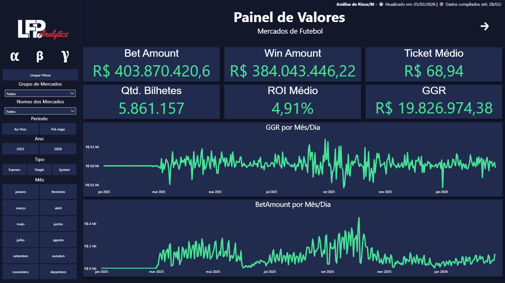
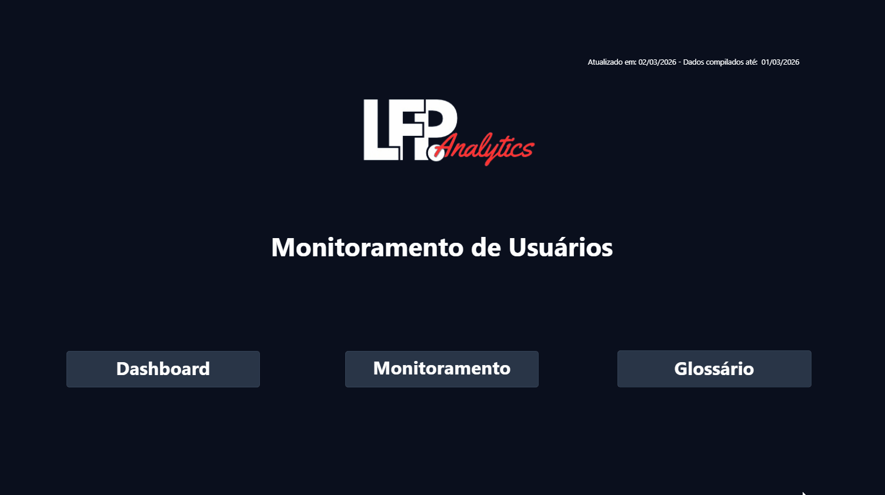

# Hi, I'm Leandro Franco Penteado👋
### BI & Data Analyst | SQL, Power BI, DAX, Star Schema Modeling & Business Metrics

Data Analytics professional specialized in converting transactional data into strategic business insights. Experienced in data modeling (Star Schema), SQL query optimization, ETL processes, and executive dashboards for **iGaming, Sports Betting, and Risk Management**.

---

## 🚀 Technical Stack
- **Databases & Querying:** SQL (PostgreSQL, BigQuery, MySQL), DAX, Python (Pandas).
- **BI & Data Visualization:** Power BI, Metabase, Advanced Excel.
- **Data Engineering & Modeling:** Star Schema, Dimensional Modeling, ETL Pipelines.
- **Business Domains:** GGR/NGR Metrics, Risk & Fraud Analytics, RFM Segmentation, Churn Analysis.

---

## 📌 Featured Projects

### 1. 📊 [Sports Betting Market Performance & GGR Analytics](https://github.com/leandro-francop/sports-betting-market-analytics)
Executive multi-tenant dashboard evaluating market volume, Gross Gaming Revenue (GGR), and hold rates across football leagues.
- **Stack:** Power BI, Advanced DAX, SQL, Star Schema.

---

### 2. 🛡️ [Player Risk & Anomaly Detection Engine](https://github.com/leandro-francop/player-risk-anomaly-detection)
Operational dashboard for monitoring player behavior, identifying high-risk patterns, and managing financial exposure.
- **Stack:** Power BI, DAX, Risk Matrix Modeling, Behavioral Analytics.

---

## 📬 Connect
- **LinkedIn:** [linkedin.com/in/leandro-franco-penteado](https://www.linkedin.com/in/leandro-franco-penteado)
- **Email:** l.francop@outlook.com
